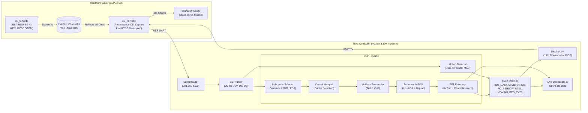

# WiBreathe: Contactless Respiration & Bed-Exit Detection Using Wi-Fi CSI on ESP32

[](https://www.python.org/downloads/)
[](https://docs.espressif.com/projects/esp-idf/en/release-v5.5/)
[](LICENSE)

**Experiential Learning Phase 2 Prototype**  
**Institution**: RV College of Engineering, Bengaluru  
**Team**: Mugglelabs  

---

> [!CAUTION]
> **ACADEMIC RESEARCH PROTOTYPE — NOT A MEDICAL DEVICE**  
> WiBreathe is designed solely for engineering education and academic contactless RF sensing research. It has **NOT** undergone medical device certification (e.g., FDA 510(k), CE-MDR, CDSCO), is **NOT** clinically validated, and **MUST NEVER** be used for medical diagnosis, clinical vital sign monitoring, apnea alarms, pediatric crib monitoring, or critical care life support.

---

## 1. System Architecture

WiBreathe senses minute chest wall displacements (~1–12 mm) and gross occupant body movement by measuring subcarrier-level Channel State Information (CSI) from 802.11n Wi-Fi OFDM packets transmitted across a bed or cot.



---

## 2. Hardware Wiring & Bill of Materials

### 2.1 Bill of Materials
- **2x ESP32-S3 DevKitC-1** (or classic ESP32 DevKit v1 / ESP32-C3)
- **1x 0.96" SSD1306 128x64 I2C OLED Display**
- **2x 4-wire USB data cables** (Type-C or Micro-USB depending on board)
- **1x 5V USB battery pack** (for isolated TX node operation)
- **4x Female-to-Female jumper wires**

### 2.2 Receiver Wiring Table
Connect the SSD1306 OLED display to the receiver board:

| SSD1306 OLED Pin | ESP32-S3 Pin | Classic ESP32 Pin | ESP32-C3 Pin | Description |
| :--- | :--- | :--- | :--- | :--- |
| **GND** | **GND** | **GND** | **GND** | Ground |
| **VCC** | **3V3** | **3V3** | **3V3** | 3.3V Power Rail |
| **SDA** | **GPIO 8** | **GPIO 21** | **GPIO 4** | I2C Serial Data |
| **SCL** | **GPIO 9** | **GPIO 22** | **GPIO 5** | I2C Serial Clock |

> [!NOTE]
> On ESP32-S3 boards equipped with dual Type-C ports, plug the cable into the port marked **UART** (connected to the CP2102/CH340 chip). Do not use the native USB port.

See [docs/WIRING.md](file:///Users/rgo75/work/wibreathe/docs/WIRING.md) for full hardware schematics and noise decoupling advice.

---

## 3. Toolchain Installation

### 3.1 Host Python Environment (macOS / Linux / Windows)
WiBreathe requires **Python 3.10+**.

```bash
# Clone the repository
git clone https://github.com/mugglelabs/wibreathe.git
cd wibreathe

# Create and activate virtual environment
python3 -m venv .venv
source .venv/bin/activate   # On Windows: .venv\Scripts\activate

# Install dependencies and package in editable mode
pip install --upgrade pip
pip install -r requirements.txt
pip install -e .
```

### 3.2 ESP-IDF v5.x Setup
Target: **ESP-IDF v5.5.6** (or any ESP-IDF v5.x release).

```bash
# macOS / Linux Prerequisites
sudo apt-get install git wget flex bison gperf python3 python3-pip python3-venv cmake ninja-build ccache libffi-dev libssl-dev dfu-util  # Linux
# Or macOS with Homebrew:
brew install cmake ninja dfu-util

# Clone ESP-IDF v5.5
mkdir -p ~/esp
cd ~/esp
git clone -b release/v5.5 --recursive https://github.com/espressif/esp-idf.git esp-idf-v5.5
cd esp-idf-v5.5
./install.sh esp32s3,esp32,esp32c3

# Activate ESP-IDF environment (run in your shell before building firmware)
. ~/esp/esp-idf-v5.5/export.sh
```

---

## 4. Firmware Build & Flashing

### 4.1 Transmitter Node (`csi_tx`)
```bash
cd firmware/csi_tx

# Set silicon target (esp32s3, esp32, or esp32c3)
idf.py set-target esp32s3

# Build and flash to TX board
idf.py build
idf.py -p /dev/tty.usbserial-TX_PORT -b 921600 flash
```

### 4.2 Receiver Node (`csi_rx`)
```bash
cd ../csi_rx

# Set target, build, and flash to RX board
idf.py set-target esp32s3
idf.py build
idf.py -p /dev/tty.usbserial-RX_PORT -b 921600 flash monitor
```

---

## 5. Command-Line Interface (CLI) Reference

The `wibreathe` CLI provides an integrated suite of tools for hardware bringup, data streaming, synthetic simulation, and clinical evaluation:

### 5.1 `list-ports`
Detect available serial ports and USB-UART bridges:
```bash
python -m wibreathe list-ports
```

### 5.2 `check-link`
Verify CSI packet rate (nominal 50 Hz), packet loss (< 2%), and RSSI:
```bash
python -m wibreathe check-link --port /dev/tty.usbserial-0001 --baud 921600 --duration 10
```

### 5.3 `record`
Stream and log live raw CSI packets to `data/raw/` with JSON metadata sidecars:
```bash
python -m wibreathe record \
    --port /dev/tty.usbserial-0001 \
    --baud 921600 \
    --volunteer V01 \
    --mode normal \
    --duration 60
```

### 5.4 `simulate`
Generate biologically realistic synthetic CSI packets (respiration, harmonics, noise, motion bursts, bed-exit) for pipeline validation without hardware:
```bash
python -m wibreathe simulate \
    --duration 60 \
    --rate 16.0 \
    --noise 0.2 \
    --out data/raw/sim_respiration.csv
```

### 5.5 `replay`
Replay recorded or synthetic CSV sessions through the live DSP, state machine, and OLED display link:
```bash
python -m wibreathe replay --file data/raw/sim_respiration.csv --speed 1.0
```

### 5.6 `plot`
Generate publication-quality 4-panel diagnostic PNG figures:
```bash
python -m wibreathe plot --file data/raw/sim_respiration.csv --out data/results/plot.png
```

### 5.7 `tap`
Cross-platform keystroke reference tap logger for synchronizing volunteer ground truth:
```bash
python -m wibreathe tap --volunteer V01 --mode normal --session 1
```

### 5.8 `eval`
Compute quantitative benchmarks (MAE, RMSE, bias, coverage, confusion matrix, and Bland-Altman statistics):
```bash
python -m wibreathe eval \
    --est data/processed/V01_normal_est.csv \
    --ref data/reference/V01_normal_ref.csv \
    --out data/results/V01_eval_report.md
```

---

## 6. Configuration Guide (`config/default.yaml`)

All signal processing, hardware, and state machine parameters are centralized in `config/default.yaml`:

```yaml
serial:
  baudrate: 921600
  buffer_size: 65536
  read_timeout_s: 2.0

subcarriers:
  null_indices: [-32, -31, -30, -29, 0, 28, 29, 30, 31]
  selection_method: "variance"  # variance, snr, pca, or mean
  top_k: 5

resample:
  target_rate_hz: 20.0
  max_gap_s: 0.5

hampel:
  window_size: 7
  n_sigmas: 3.0
  min_deviation_floor: 3.0

bandpass:
  lowcut_hz: 0.10   # 6 breaths per minute
  highcut_hz: 0.50  # 30 breaths per minute
  order: 4

breathing:
  fft_zero_pad_factor: 8
  parabolic_interpolation: true
  min_prominence: 0.05
  window_duration_s: 15.0
  step_duration_s: 1.0

motion:
  mad_low_threshold: 0.04
  mad_high_threshold: 0.12
  window_duration_s: 1.0

state_machine:
  empty_bed_threshold: 0.015
  no_person_timeout_s: 5.0
  bed_exit_motion_decay_s: 3.0
```

---

## 7. Data Folder Organization

The data directory strictly follows this structure (all data directories are excluded from git):

```
data/
├── raw/        # Raw CSI CSV files and JSON metadata sidecars (V01_normal_*.csv, *.json)
├── processed/  # Resampled and filtered timeseries datasets
├── reference/  # Synchronized manual tap tool ground-truth CSVs
└── results/    # Evaluation markdown reports, CSV error metrics, and session PNG plots
```

---

## 8. Troubleshooting & Common Pitfalls

| Issue | Likely Cause | Resolution |
| :--- | :--- | :--- |
| **No COM/tty port enumerates** | Charge-only USB cable | Replace cable with a verified 4-wire data cable. |
| **Host freezes / dropped bytes on ESP32-S3** | Cable plugged into native USB-JTAG port | Connect to the port marked **UART** (CP2102/CH340 chip). |
| **Zero CSI packets received** | 802.11b rate default on ESP-NOW | ESP32 Wi-Fi hardware only computes CSI on OFDM frames. TX must call `esp_now_set_peer_rate_config` with `WIFI_PHY_MODE_HT20` and `WIFI_PHY_RATE_MCS0_LGI`. |
| **Garbled serial characters** | Baud rate mismatch | Ensure host reader is configured to `921600` baud. |
| **OLED display is blank** | I2C pin mismatch or missing pull-ups | On ESP32-S3, verify SDA=GPIO 8, SCL=GPIO 9. Add 4.7kΩ pull-up resistors if cables exceed 15 cm. |
| **Breathing peak suppressed or flatline** | Hampel filter clamping natural slope | Ensure `min_deviation_floor` (default 3.0) is configured in Hampel filter. |
| **Subharmonic beats in respiration** | Windowed median filter on non-integer periods | Use linear or polynomial detrending; avoid short rolling median detrending on sine waves. |
| **CSI callback crashes on boot** | Dynamic memory allocation in ISR context | Never call `malloc()` or `printf()` inside `csi_rx_callback`. Use FreeRTOS `xQueueSendFromISR`. |

---

## 9. Ethics, Privacy & Limitations

1. **Human Volunteer Ethics**: All human data collection must strictly follow [docs/TRIAL_PROTOCOL.md](file:///Users/rgo75/work/wibreathe/docs/TRIAL_PROTOCOL.md), including informed written consent and full freedom to withdraw.
2. **Participant Anonymity**: Never record names or identifiable health details. Use strictly de-identified keys (`V01`, `V02`).
3. **RF Safety**: WiBreathe operates at standard Wi-Fi transmission power levels ($\le 20\text{ dBm}$ / $100\text{ mW}$ EIRP), well below FCC/ICNIRP human RF exposure limits.
4. **Multipath Sensitivity**: Performance is subject to multipath changes from other moving individuals in the room. Controlled, single-occupant experimental rooms are required.
5. **No Medical Claims**: Outputs represent experimental physical channel perturbations, not clinical respiratory parameters.
